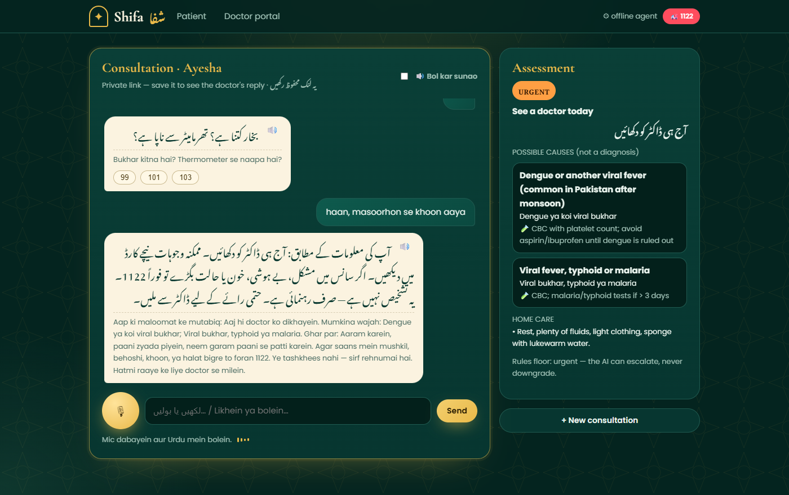
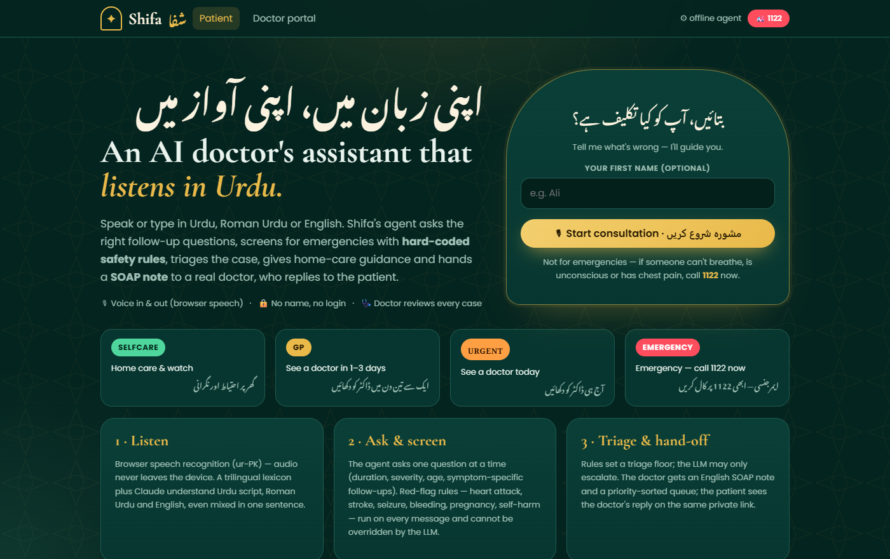
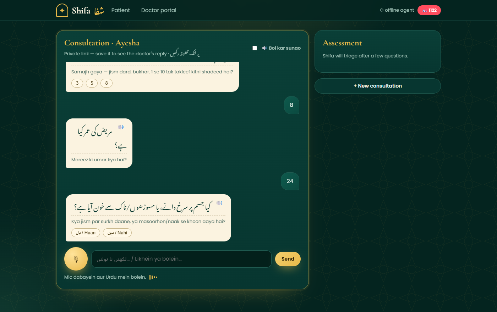
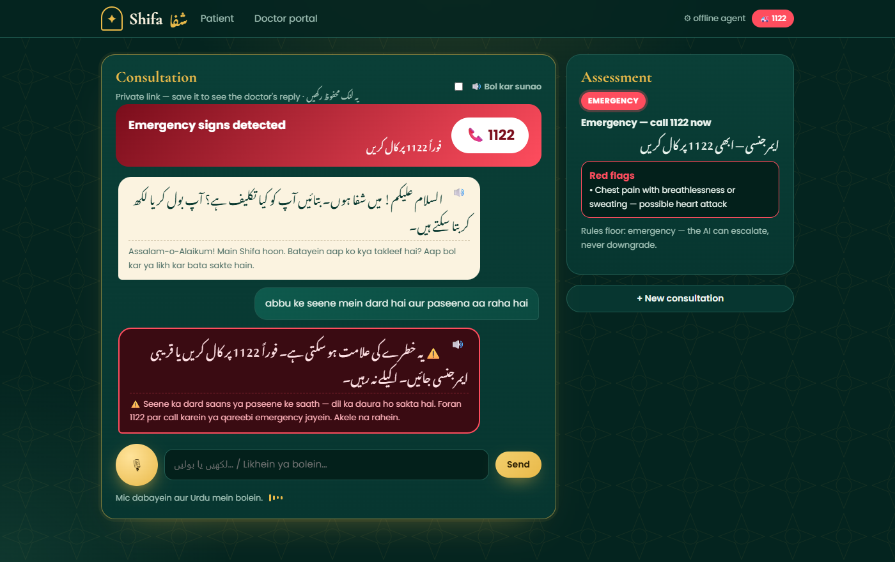
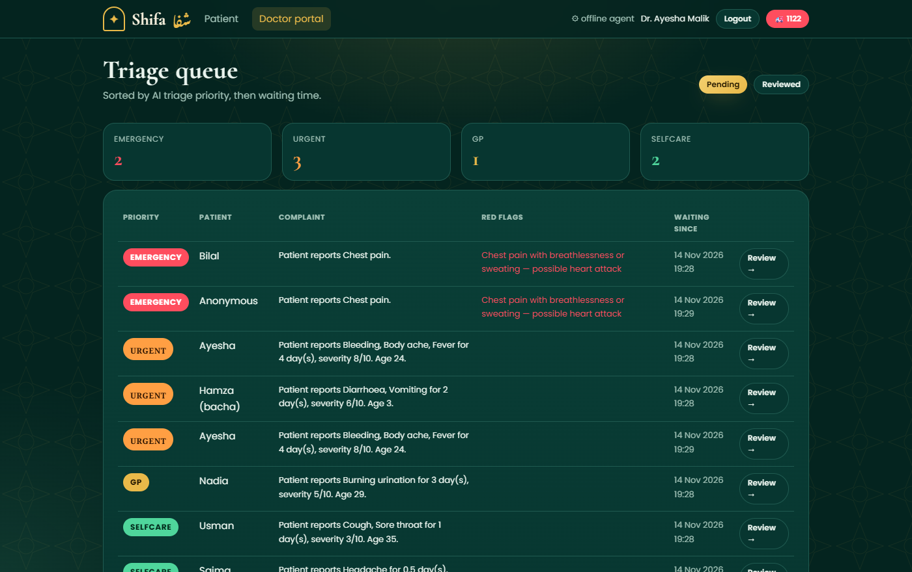
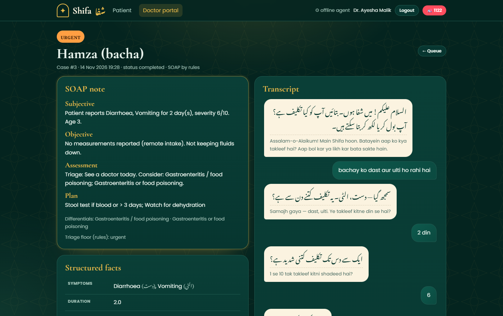

# Shifa AI — شفا · Urdu Voice Doctor Agent

> **Showcase repository.** The source code is private. Screenshots, architecture and the safety design are below. Code walkthroughs are available on request.

**Live demo:** https://muazzam-shifa.vercel.app
- **Patients:** start a consultation without signing up. Voice input works in Chrome or Edge.
- **Doctor portal:** log in as `dr.ayesha@shifa.test` / `Demo@12345`.

**Author:** Muazzam Khan



## What it does

Millions of Pakistanis describe their health problems best in Urdu, Punjabi or Roman Urdu, and often by speaking rather than typing. Shifa is a medical **intake and triage agent** built for them:

1. **Listen.** The patient speaks (browser speech recognition, `ur-PK`) or types in Urdu script, Roman Urdu or English, or a mix of these. Replies come back in **Nastaliq Urdu with a Roman Urdu line** and can be read aloud with text-to-speech.
2. **Ask.** The agent asks one empathetic question at a time:
   - The core questions are duration, severity and age.
   - It adds follow-ups that depend on the symptom: fever → temperature, plus rash or bleeding (dengue warning signs); diarrhoea or vomiting → hydration; cough → chronic illness.
   - It understands answers such as `kal se`, `۱۰۲`, `39` (converted from °C) and `ہاں`.
3. **Screen for emergencies on every message.** These red-flag rules are deterministic, so they run first and the LLM cannot skip them: heart attack, stroke, seizure or unconsciousness, severe breathlessness, heavy bleeding, bleeding in pregnancy, and self-harm. Any red flag immediately shows a **call 1122** screen.
4. **Triage.** Each case gets one of four levels: Emergency, Urgent (today), GP (1–3 days) or Self-care.
   - Clinical rules set a **triage floor**.
   - Claude **may escalate the level but can never downgrade it**.
   - The patient sees possible causes (clearly labelled "not a diagnosis"), suggested tests and home-care advice.
5. **Hand off to a doctor.** The case goes to a **doctor portal**:
   - Cases appear in a queue sorted by priority, each with an **English SOAP note** generated from the Urdu transcript.
   - The doctor reviews the case, can adjust the triage, and writes a note.
   - The patient sees the doctor's reply on their private link.

## Safety & privacy engineering

- **Defence in depth:** red flags are checked with rules before the LLM runs, the triage floor is enforced after it, and the LLM's structured output is validated against fixed ids. If Claude fails, the app falls back to the rule-based interview.
- **No diagnosis, no prescriptions or doses.** Every assessment carries a disclaimer and routes the patient to a clinician.
- **Voice never reaches the server.** Speech recognition runs in the browser, and the app sets `Permissions-Policy: microphone=(self)`.
- **Anonymous patients.** No account and no name are needed; each patient gets an unguessable consultation link. Only doctors can see the queue.
- **Other protections:** rate limits, a message cap, CSRF protection and strict security headers.
- **Tests:** 26 tests covering:
  - trilingual symptom extraction and answer parsing (Urdu digits, °C → °F)
  - 5 red-flag scenarios
  - the dengue, child-dehydration and headache flows
  - "the LLM can escalate but never downgrade"
  - an LLM-added red flag
  - the doctor round-trip and priority sorting

| Landing | Urdu interview | Emergency |
|---|---|---|
|  |  |  |

| Doctor triage queue | SOAP note & transcript |
|---|---|
|  |  |

## Architecture

```
Browser (Web Speech STT ur-PK · TTS) ──► Flask
   agent.turn():  parse pending answer → extract symptoms (Urdu/Roman/English lexicon)
                  → RED-FLAG RULES (always) → Claude structured turn (understand · next question · may escalate)
                  → next question | assessment (rules floor ⊔ LLM) → SOAP note (Claude / rules)
   Doctor portal: priority queue · SOAP · transcript · reply & re-triage
PostgreSQL (Neon) · SQLAlchemy · LangChain + Claude (claude-opus-5-5) · Vercel
```

Without an `ANTHROPIC_API_KEY`, the app runs in a clearly labelled **offline mode**, using the structured rule-based interview and template SOAP notes. The safety rules are identical in both modes.

*Educational demo; not a medical device and not a substitute for professional care.*
